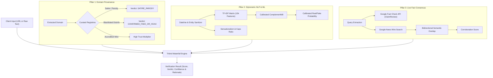

# Fake News Detection Engine (Tribrid Intelligence v2.1)
### High-Throughput Probabilistic NLP & Live Fact Consensus Verification Architecture

[](https://www.python.org/)
[](https://fastapi.tiangolo.com/)
[](https://scikit-learn.org/)
[-brightgreen.svg)]()
[]()
[]()
[](LICENSE)
[](Dockerfile)

---

## 1. Executive Overview

**Fake News Detection Engine** is an enterprise-grade artificial intelligence and fact-checking system engineered to detect fabricated news articles, clickbait, and coordinated disinformation campaigns. 

Built on a **defense-in-depth Tribrid architecture**, the system decouples stylistic analysis from ground-truth verification:
1. **Pillar 1 — Source Provenance & Domain Reputation:** Real-time domain verification against curated blacklists, satire registries, and IFCN-certified fact-checking desks.
2. **Pillar 2 — Stylometric NLP & Calibrated Naive Bayes:** Sublinear $(1, 2)$-gram TF-IDF vectorization paired with a tuned, probability-calibrated **Complement Naive Bayes (CNB)** classifier with clickbait heuristic profiling.
3. **Pillar 3 — Live Fact Consensus & News Wire Search:** Real-time cross-referencing via Google News RSS feeds and Google Fact Check Tools API (ClaimReview schema) using weighted bidirectional Jaccard semantic matching.
4. **Waterfall Arbiter:** A deterministic decision engine that synthesizes signals from all three pillars, mitigating the concept drift inherent in static ML models without falling into the "absence of evidence" fallacy.



---

## 2. Repository Architecture

```
Fake-news-detection-Engine/
├── .github/
│   └── workflows/
│       └── ci.yml                     # Continuous Integration & Automated Test Suite
├── data/
│   ├── raw/
│   │   └── .gitkeep                   # Target directory for raw benchmark CSVs
│   ├── processed/
│   │   └── .gitkeep                   # Target directory for perturbed CSVs
│   └── sample/
│       └── sample_articles.csv        # Representative offline test samples
├── docs/                              # Project specifications & technical reports
│   ├── Fake_News_Detection_Comprehensive_Project_Report.pdf # 11-Page Master Technical PDF
│   ├── Team2_Fake_News_Detection_PRD_TRD_PD_2.md            # Product & Technical Requirements
│   ├── Final_Project_Report.md        # Summary engineering report
│   ├── Model_Optimization_and_Scraping_QnA.md               # Concept drift & architecture Q&A
│   └── audit_log.txt                  # Model verification & split audit trail
├── models/                            # Serialized production model artifacts
│   ├── complement_nb.pkl              # Tuned & calibrated ComplementNB classifier
│   ├── tfidf_vectorizer.pkl           # Fitted 10,000-feature TF-IDF matrix
│   ├── noisy_complement_nb.pkl        # Robustness model trained on perturbed corpus
│   └── noisy_tfidf_vectorizer.pkl     # Vectorizer fitted on perturbed corpus
├── outputs/                           # Publication-grade visual diagnostics (300 DPI)
│   ├── confusion_matrix.png           # Confusion matrix (Clean model)
│   ├── roc_curve.png                  # ROC comparison curves (MNB vs CNB vs Calibrated)
│   ├── learning_curve.png             # Bias/variance convergence curve
│   ├── wordcloud_fake.png             # Fabricated news linguistic word cloud
│   └── wordcloud_real.png             # Authentic news linguistic word cloud
├── src/                               # Executable application source code
│   ├── common/
│   │   ├── __init__.py                # Package initialization
│   │   └── preprocessing.py           # Canonical sanitization, dateline stripping & lemmatization
│   ├── inference/
│   │   ├── __init__.py                # Inference exports
│   │   ├── domain_verifier.py         # Pillar 1: Domain provenance evaluation
│   │   ├── stylometry.py              # Pillar 2: Stylometrics & calibrated ML inference
│   │   ├── fact_checker.py            # Pillar 3: ClaimReview & wire consensus cross-referencing
│   │   ├── scraper.py                 # SSRF-hardened article scraper
│   │   └── fusion_engine.py           # Tribrid waterfall arbiter orchestrator
│   ├── static/                        # Frontend web dashboard assets
│   │   ├── app.js                     # Dashboard interaction logic & gauge animation
│   │   ├── index.html                 # Single-page web dashboard
│   │   └── style.css                  # Modern UI stylesheet
│   ├── app.py                         # FastAPI REST application server
│   ├── cli.py                         # Interactive & command-line inference tool
│   ├── config.py                      # Centralized configuration & environment loader
│   ├── download_data.py               # Dataset acquisition helper
│   ├── evaluate_robustness.py         # Cross-dataset stress testing harness
│   ├── generate_noisy_data.py         # Adversarial noise perturbation generator
│   ├── generate_report.py             # 11-Page PDF technical report generator
│   ├── main_pipeline.py               # Backward-compatible training wrapper
│   ├── noisy_pipeline.py              # Backward-compatible noisy training wrapper
│   └── pipeline.py                    # Unified high-performance training pipeline
├── tests/                             # Comprehensive automated pytest suite
│   ├── __init__.py                    # Test package
│   ├── test_api.py                    # REST API endpoint tests
│   ├── test_fact_checker.py           # Overlap & ClaimReview logic tests
│   ├── test_fusion_engine.py          # Waterfall arbitration policy tests
│   ├── test_preprocessing.py          # Dateline sanitization & entity preservation tests
│   ├── test_scraper.py                # SSRF prevention & slug parsing tests
│   └── test_stylometry.py             # Heuristics & calibrated probability tests
├── .env.example                       # Environment configuration template
├── .gitignore                         # Enterprise Git ignore patterns
├── CONTRIBUTING.md                    # Contribution guidelines
├── docker-compose.yml                 # Multi-container orchestration
├── Dockerfile                         # Enterprise multi-stage non-root container
├── LICENSE                            # MIT License
├── pyproject.toml                     # Modern Python packaging configuration
├── pytest.ini                         # Pytest configuration & warning filters
└── requirements.txt                   # Production pinned dependencies
```

---

## 3. Quick Start & Execution Guide

### Option A: Running with Docker (Recommended for Production)

```bash
# 1. Build and start the container
docker compose up -d

# 2. View container logs
docker compose logs -f

# 3. Access Web Dashboard
# Open http://localhost:8000 in your browser
```

---

### Option B: Local Python Environment Setup

#### 1. Clone the repository:
```bash
git clone https://github.com/BEAST-AMMAR/Fake-news-detection-Engine.git
cd Fake-news-detection-Engine
```

#### 2. Create and activate a virtual environment:
```bash
python -m venv .venv

# Windows (PowerShell):
.\.venv\Scripts\Activate.ps1

# Linux / macOS:
source .venv/bin/activate
```

#### 3. Install dependencies:
```bash
pip install -r requirements.txt
```

#### 4. Fetch NLTK corpora:
```bash
python -c "import nltk; nltk.download('stopwords'); nltk.download('wordnet'); nltk.download('omw-1.4')"
```

---

## 4. Operational Usage

### 1. Launch the Modern Web Intelligence Dashboard
```bash
python -m uvicorn src.app:app --host 127.0.0.1 --port 8000 --reload
```
Navigate to **`http://127.0.0.1:8000`** in your browser.

### 2. Interactive Terminal CLI
```bash
# Launch interactive verification terminal
python src/cli.py --interactive

# Verify by Article URL
python src/cli.py --url "https://theonion.com/..."

# Verify by Raw Text & Headline
python src/cli.py --title "European Central Bank holds rates steady" --text "FRANKFURT - The European Central Bank maintained interest rates on Thursday as consumer inflation showed deceleration across the eurozone."
```

### 3. Execute the Automated Test Suite (25 Tests)
```bash
pytest tests/ -v
```

### 4. Train the Machine Learning Pipeline
Pre-trained, calibrated models are included in `models/`. To retrain from scratch:
```bash
# Ingest full Kaggle dataset if needed
python src/download_data.py

# Train clean calibrated model
python src/pipeline.py --mode clean --workers 4

# Train adversarial noisy model
python src/pipeline.py --mode noisy --workers 4

# Run cross-model robustness evaluation
python src/evaluate_robustness.py
```

### 5. Compile Technical PDF Report
Generates publication-quality 11-page master document in `docs/`:
```bash
python src/generate_report.py
```

---

## 5. Performance Benchmarks

### Primary Model Evaluation (Unseen Clean Test Partition: 7,820 samples)
*Evaluated on clean corpus with publisher attribution and datelines removed to eliminate watermark leakage.*

| Metric | MultinomialNB (Baseline) | ComplementNB (Default) | Best Calibrated ComplementNB ($\alpha=0.001$) | Target KPI |
| :--- | :---: | :---: | :---: | :---: |
| **Accuracy** | 94.77% | 94.82% | **95.40%** | $\ge 90.0\%$ |
| **Precision (Macro)** | 94.73% | 94.75% | **95.37%** | $\ge 85.0\%$ |
| **Recall (Macro)** | 94.74% | 94.84% | **95.36%** | $\ge 85.0\%$ |
| **F1-Score (Macro)** | 0.9473 | 0.9479 | **0.9536** | $\ge 0.88$ |
| **ROC-AUC** | 0.9871 | 0.9871 | **0.9896** | $\ge 0.92$ |
| **Preprocessing Time** | ~3.5 min (serial) | ~3.5 min (serial) | **31.9 sec** (parallel) | $< 5.0\text{ min}$ |
| **Model Size** | 388 KB | 400 KB | **400 KB** | $< 15\text{ MB}$ |

### Adversarial Robustness Benchmark (10% Typo Corruption Partition: 8,973 samples)

| Evaluated Model | Evaluation Condition | Accuracy | Macro F1 | Resilience Retention |
| :--- | :--- | :---: | :---: | :---: |
| **Clean Model** | Clean Test Data | 95.40% | 0.9536 | 100.0% (Ref) |
| **Clean Model** | 10% Adversarial Corrupted Data | **95.06%** | **0.9505** | **99.64%** |
| **Noisy Model** | 10% Adversarial Corrupted Data | **95.42%** | **0.9541** | **100.02%** |

---

## 6. Security Architecture & Threat Mitigations

1. **Server-Side Request Forgery (SSRF) Defense:**
   In `src/inference/scraper.py`, outbound URL fetching executes pre-flight DNS address validation. Requests targeting private networks (`10.0.0.0/8`, `172.16.0.0/12`, `192.168.0.0/16`), loopback (`127.0.0.0/8`, `::1`), link-local metadata (`169.254.169.254`), or non-HTTP schemes are blocked.
2. **Denial-of-Service (DoS) Protection:**
   The REST endpoint enforces strict schema-level input boundaries (`max_length=50,000` for text, `1,000` for titles) and HTTP client timeouts ($12.0\text{s}$) to prevent resource exhaustion.
3. **Data Leakage & Attribution Sanitization:**
   Authentic articles from news datasets frequently leak the publisher's identity (e.g. `(Reuters) - `). The canonical preprocessor (`src/common/preprocessing.py`) strips datelines and agency tags prior to vectorization, ensuring the classifier learns syntactic veracity rather than publisher signatures.
4. **Adversarial Overlap Mitigation:**
   Pillar 3 computes **bidirectional Jaccard similarity** and filters generic news vocabulary, preventing hoaxes from falsely claiming corroboration from unrelated mainstream articles that happen to share common background tokens.

---

## 7. REST API Documentation

### Health Check
* **`GET /api/health`**
  ```json
  {
    "status": "healthy",
    "engine": "Tribrid Fusion v2.1 (Hardened)",
    "pillars": {
      "pillar_1": "Domain Reputation & Provenance (Curated Media Bias / IFCN Desks)",
      "pillar_2": "Stylometric NLP (Complement Naive Bayes + Heuristics)",
      "pillar_3": "Live Fact Consensus (ClaimReview & Wire Search)"
    }
  }
  ```

### Verify News Item
* **`POST /api/verify`**
  * **Payload (JSON):**
    ```json
    {
      "url": "https://www.reuters.com/markets/rates-bonds/...",
      "title": "Optional article title",
      "text": "Optional raw article text"
    }
    ```
  * **Response (JSON):**
    ```json
    {
      "url": "https://www.reuters.com/markets/rates-bonds/...",
      "title": "Global central banks hold benchmark rates steady",
      "author": "Journalist Name",
      "publish_date": "2026-10-28",
      "word_count": 420,
      "credibility_score": 93.0,
      "verdict": "VERIFIED_TRUE",
      "confidence_level": "HIGH",
      "primary_reason": "Published by accredited organization (reuters.com) and corroborated across major news wires.",
      "pillar_1_domain": { "domain": "reuters.com", "category": "REPUTABLE", "trust_score": 0.95 },
      "pillar_2_stylometry": { "real_probability": 0.984, "fake_probability": 0.016, "stylometric_label": "REAL_STYLE" },
      "pillar_3_fact_consensus": { "wire_count": 2, "consensus_score": 0.95 },
      "execution_time_ms": 312.4
    }
    ```

---

## 8. License & Authors

* **License:** [MIT License](LICENSE)
* **Author:** **MUHAMMAD AMMAR** ([muhammada.23.beai@acharya.ac.in](mailto:muhammada.23.beai@acharya.ac.in))
* **Dataset Attribution:** ISOT Fake News Dataset (University of Victoria) / Kaggle mirror by `emineyetm`.
